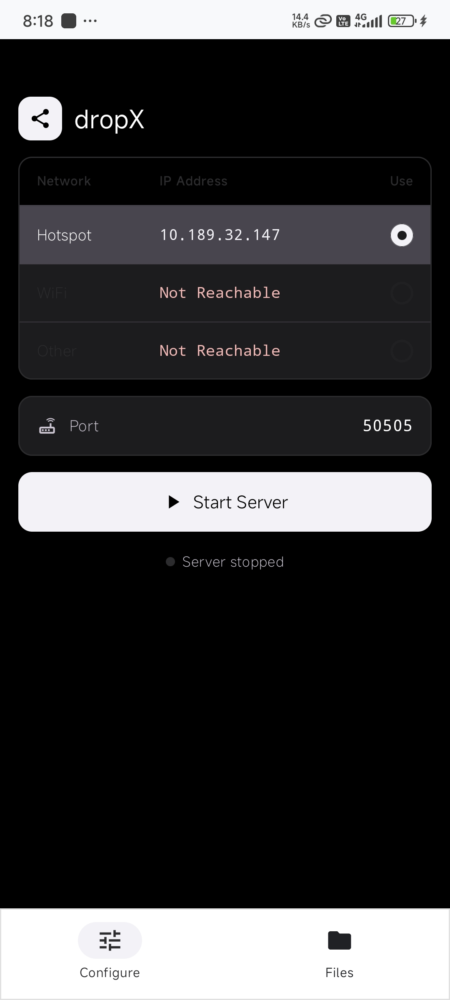
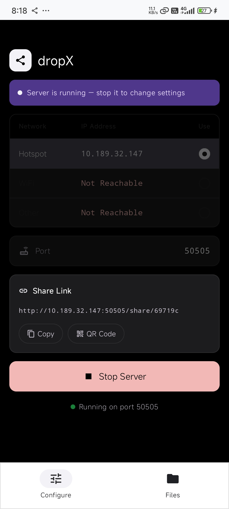
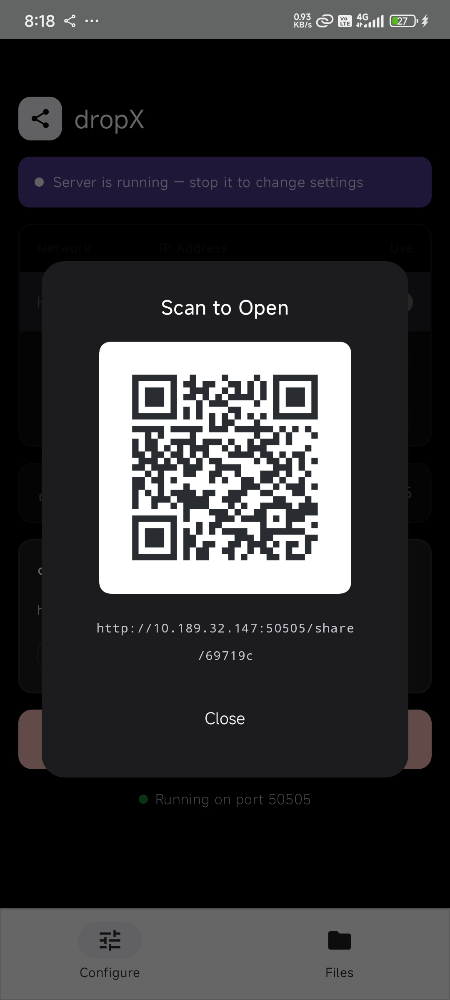
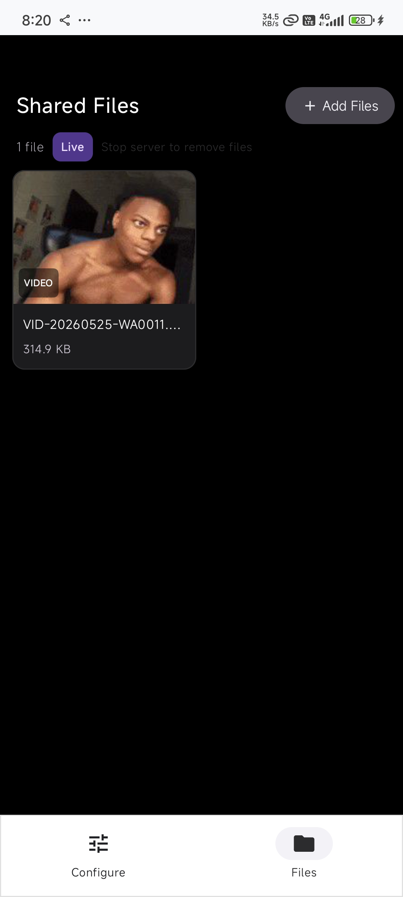
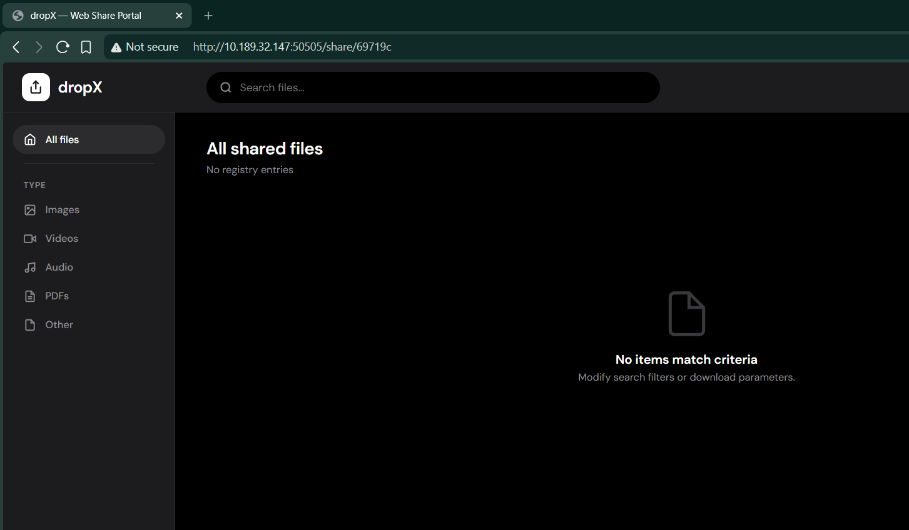
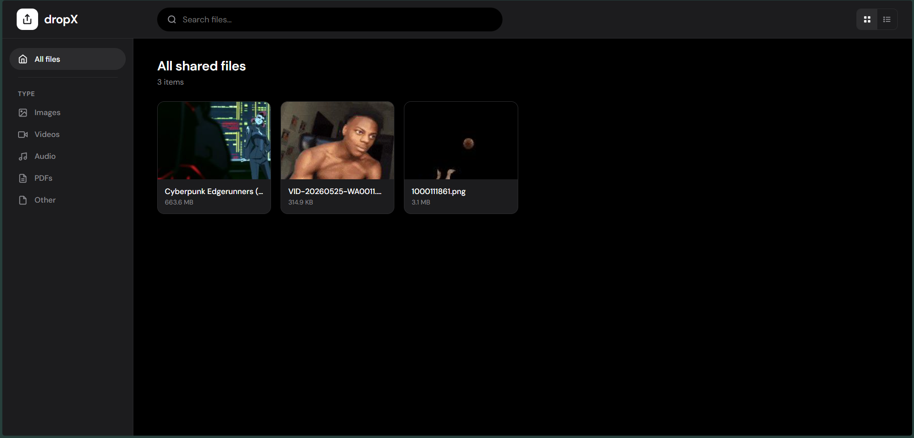
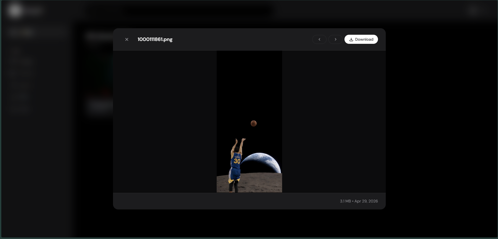
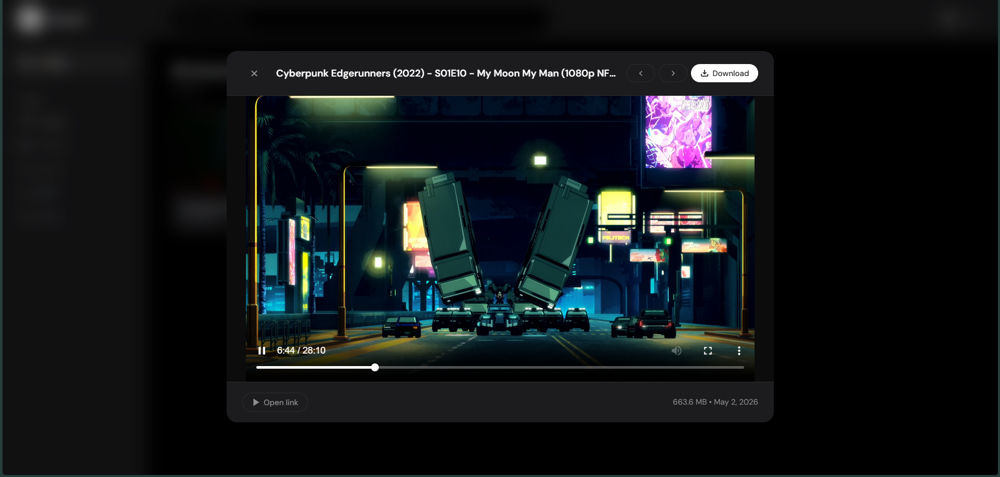
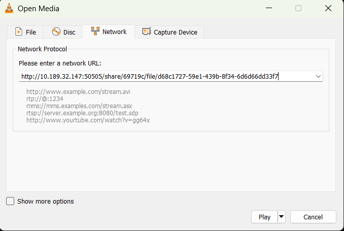
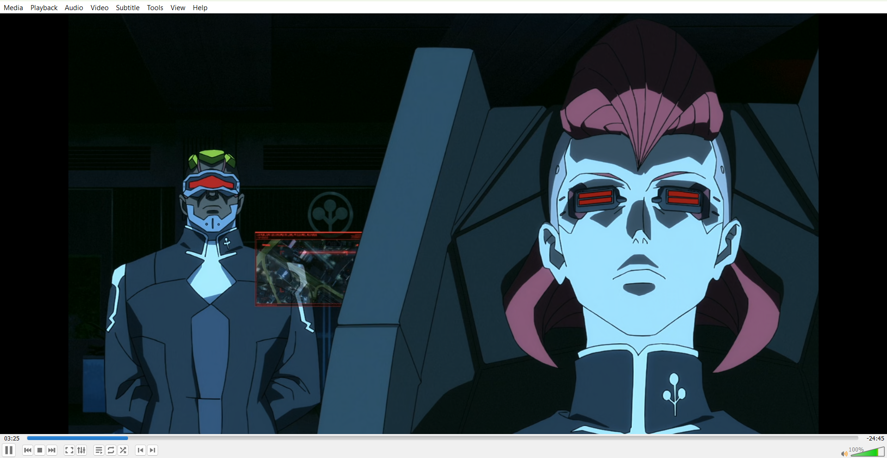

# dropX

Share files from your Android phone to any device on the same Wi-Fi network or hotspot. The other person opens a link in a browser. They don't need an app or an account, and nothing is uploaded anywhere.

No ads, no tracking, no account.

---

## Screenshots

| Configure | Server Running | QR Code | Files |
| --- | --- | --- | --- |
| [](docs/screenshots/1.dropX_app_configure_screen.jpeg) | [](docs/screenshots/2.dropX_app_start_server.jpeg) | [](docs/screenshots/3.dropX_app_share_qr.jpeg) | [](docs/screenshots/4.dropX_app_files_screen.jpeg) |

| Web Portal Main | Web Portal Directory | Image Preview | Video Player Stream |
| --- | --- | --- | --- |
| [](docs/screenshots/5.dropX_web.png) | [](docs/screenshots/6.dropX_web_all_files.png) | [](docs/screenshots/7.dropX_web_image_stream.png) | [](docs/screenshots/8.dropX_web_video_stream.png) |

| Stream Setup (VLC) | Live VLC Network Playback |
| --- | --- |
| [](docs/screenshots/9.dropX_vlc_network_stream.png) | [](docs/screenshots/10.dropX_vlc_network_stream2.png) |

---

## How it works

You pick files in the app and tap **Start Server**. The app shows a link and a QR code. Open the link in any browser on the same network and you get a page where you can view, stream or download the files.

The phone is the server. Files are read from where they already are on the phone and sent straight to the other device. Nothing is copied, and nothing goes through the internet.

---

## Install

Download the APK from the [Releases](https://github.com/flu1d3v/dropX/releases) page. It needs Android 10 or newer on the phone that shares the files. The device that opens the link can be anything with a browser.

---

## Streaming and downloads

**In the browser.** Videos and audio play in the page if your browser supports the format. Browsers can't play every format, and MKV and HEVC are common problems. If a file won't play, use **Copy link** and open the link in a media player instead.

**In a media player.** The server supports HTTP range requests, so any player that can open a network stream can play a file directly from the phone, with seeking. VLC, MX Player, mpv and IINA all work this way. The URL looks like this:

```
http://<your-ip>:<port>/share/<session-id>/file/<file-id>
```

You can copy it from the three-dot menu on a file in the app, or from the **Copy link** button in the web portal.

**Seeking.** Range requests mean that jumping to any point in a file does not read the file from the start. This was tested with a 2 GB+ 1080p movie over Wi-Fi with no noticeable delay.

**Downloads.** A download is handed to the browser's own download manager, so the file goes straight to disk and the page doesn't hold it in memory. Browsers can usually resume an interrupted download.

---

## Web portal

The receiver gets a file browser in the browser tab.

- Grid and list view
- Filter by type: images, video, audio, PDF, other
- Search by file name
- Thumbnails for images and video
- Preview in the page: images, video, audio and PDF
- Arrow keys move between files
- Select several files and download them together
- Copy link on each file

The whole portal is one HTML file inside the APK. It makes no requests to outside servers.

---

## Wi-Fi and hotspot

dropX lists the Wi-Fi and hotspot addresses separately. This matters because a common case is sharing with the person next to you by turning on your hotspot.

It reads the network interface names (`ap*`, `swlan*`, `softap*` for hotspot, `wlan*` for Wi-Fi) and shows what is available. If both are up, you choose which one to use. Phone makers don't all name interfaces the same way. If your hotspot address doesn't show up, please open an issue and include the output of `ip addr`.

---

## Running in the background

The server runs in a foreground service with a notification and a Stop button. A wake lock and a Wi-Fi lock are held while it runs, so it keeps working when the screen turns off.

- If the Wi-Fi or hotspot address disappears, dropX stops sharing and shows a notification. Your file list stays.
- Android 15 and newer limit this kind of background service to about 6 hours. When that happens, dropX stops cleanly and shows a notification. Tap it to resume with the same port and the same link.

---

## How the server works

- Ktor CIO HTTP server inside a foreground service. CIO is non-blocking, so several receivers can download different files at the same time.
- Files are served through Android's ContentResolver from their original location. Range requests jump to the right offset in the file instead of reading from the start.
- Each session gets a random 16-character ID (64 random bits) that is part of every URL.
- Thumbnails are made on demand and cached: an LRU memory cache backed by a disk cache with a 50 MB limit and automatic pruning. At most 3 thumbnails are generated at the same time.

---

## Security

dropX is built for a local network, and its security model follows from that.

- **HTTP, not HTTPS.** A self-signed certificate would show a browser warning that most people can't get past, which defeats the point of sharing without setup. Use trusted networks.
- **No login.** Anyone on the network who has the link can open the files until you stop the server. The 16-character session ID stops people from guessing links. It is not authentication.
- **Read-only.** Receivers can only download. There is no upload endpoint.
- **Nothing leaves the phone.** No telemetry, analytics, crash reporting or ads.

The full threat model is in [THREAT_MODEL.md](THREAT_MODEL.md). The privacy policy is in [PRIVACY.md](PRIVACY.md).

---

## Tech stack

- Kotlin, Jetpack Compose, Material 3 (light and dark theme)
- Ktor CIO server with partial content and auto HEAD response
- kotlinx.serialization for the file list sent to the portal
- ZXing for QR codes
- ContentResolver and DocumentFile for file access
- Thumbnail pipeline written for this app: no Glide or Coil

---

## Building

```
git clone https://github.com/flu1d3v/dropX.git
```

Open the project in Android Studio. No API keys or other setup are needed to build and run.

```
Min SDK:    29  (Android 10)
Target SDK: 36
Language:   Kotlin
```

The OWASP dependency check is set up, but it needs an NVD API key in `local.properties` to run. The build works without it and skips the scan.

```
# local.properties (not committed)
nvd.api.key=your_key_here
```

---

## Limitations

- One direction only. The receiver can't upload to the phone.
- Local network only, not over the internet.
- The file list is kept in memory. Stopping the server keeps it, but closing the app or Android ending the app's process clears it.
- Android sends, any browser receives. There is no iOS sender.
- Browsers can't play every video format. Use Copy link and a media player for those.
- On Android 15 and newer, Android's background time limit applies (see above).

---

## License

MIT